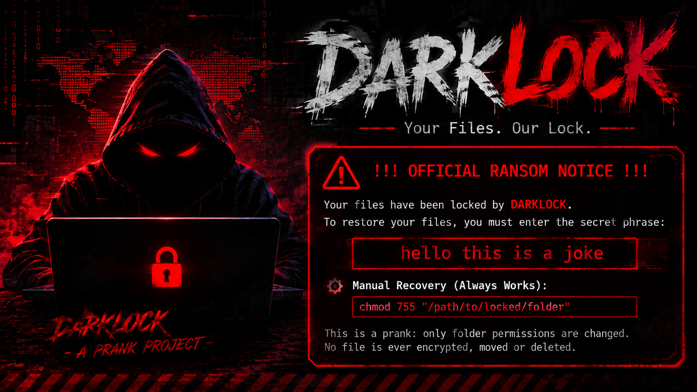

# 🔒 DARKLOCK

### A Bash-Based Ransomware Prank Simulator

**DARKLOCK** is an educational Bash project that simulates the behavior and appearance of a ransomware attack in a controlled environment.

It demonstrates folder access restriction, permission manipulation, ransom-screen simulation, and recovery mechanisms — without actually encrypting, modifying, moving, or deleting files.

> ⚠️ **Educational Project Only — No Real File Encryption**

---

## ☠️ Features

- 🔐 **Folder Locking:** Restricts access to a selected directory using Linux permissions (`chmod 000`).
- 💀 **Ransom Screen:** Displays a simulated ransomware notification.
- 🎭 **Fake Encryption Animation:** Simulates an encryption process without modifying files.
- 🔑 **Passphrase Recovery:** Restores folder permissions using a predefined secret phrase.
- 🛠️ **Manual Recovery:** Provides an alternative recovery mechanism.
- 💾 **State Management:** Saves original folder permissions for restoration.
- 🛡️ **Safety Guards:** Prevents locking protected system directories.
- 🖥️ **Terminal Interface:** Colorful terminal output and ASCII banner.

---

## ⚙️ How It Works

DARKLOCK does not use cryptographic encryption.

Instead, it changes the permissions of the selected directory:

| Operation | Description                       |
| --------- | --------------------------------- |
| Before    | Original folder permissions       |
| Lock      | `chmod 000`                       |
| During    | Folder access is restricted       |
| Recovery  | Original permissions are restored |

**Important:** Files inside the directory remain completely untouched.

---

## 🚀 Installation

Clone the repository:

```bash
git clone https://github.com/SilentSpectre-arch/DARKLOCK.git
```

Navigate to the project:

```bash
cd DARKLOCK
```

Make the script executable:

```bash
chmod +x darklock.sh
```

---

## 💻 Usage

### 1. Lock a Folder

```bash
./darklock.sh lock /path/to/test-folder
```

### 2. Lock and Exit

```bash
./darklock.sh lock --stay /path/to/test-folder
```

### 3. Display the Recovery Screen

```bash
./darklock.sh
```

### 4. Unlock a Folder

```bash
./darklock.sh unlock /path/to/test-folder
```

### 5. Display Help

```bash
./darklock.sh help
```

---

## 🔑 Recovery

The simulated ransom screen displays the following passphrase:

```text
hello this is a joke
```

DARKLOCK restores the original folder permissions after successful verification.

Manual recovery is also possible:

```bash
chmod 755 /path/to/test-folder
```

Use the original permission mode if it differs from `755`.

---

## 🛠️ Technologies

- Bash Scripting
- Linux Permissions
- chmod
- stat
- readlink
- find
- Coreutils

---

## 🛡️ Safety & Disclaimer

DARKLOCK is designed strictly for educational and demonstration purposes.

- No files are encrypted.
- No files are deleted.
- No files are moved.
- No file contents are modified.
- Only the permissions of the selected directory are changed.

**Always test in a dedicated lab directory or virtual machine.**

---

## 👤 Author

**WRAITH**

Cybersecurity | Red Team | Linux | Bash

GitHub: [SilentSpectre-arch](https://github.com/SilentSpectre-arch)

---

\<p align="center">   \<b>DARKLOCK — Your Files. Our Lock.\</b>   \<br>   \<sub>Educational Ransomware Simulation Project\</sub> \</p>
